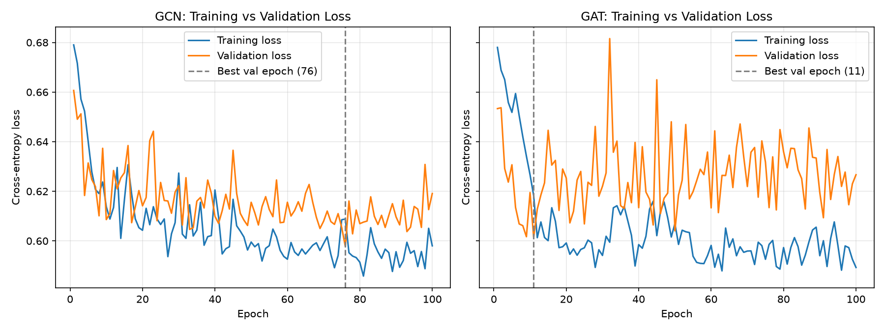

# Graph Classification on PROTEINS with GCN and GAT

## How to Install and Run

### 1. Install the required packages

Python 3.10+ is recommended.

```bash
# PyTorch (with CUDA support for an NVIDIA GPU; RTX 50-series needs CUDA 12.8+)
pip install torch --index-url https://download.pytorch.org/whl/cu128

# CPU-only alternative:
# pip install torch

# PyTorch Geometric and the other dependencies
pip install torch_geometric scikit-learn matplotlib
```

Or install everything from the requirements file:

```bash
pip install -r requirements.txt
```

### 2. Run the code (in this order)

```bash
python part1_data_exploration.py   # Part 1: load and explore PROTEINS
python part2_preprocessing.py      # Part 2: 70/10/20 train/val/test split
python part3_train.py              # Part 3: train GCN and GAT, save best checkpoints
python part4_evaluate.py           # Part 4: evaluate selected checkpoints on test set
```

The dataset is downloaded automatically to `data/TUDataset/` on the first run.
The scripts automatically use a CUDA GPU if available, otherwise the CPU.
Results in this README were produced on an NVIDIA GeForce RTX 5070 Laptop GPU.

| File | Purpose |
|---|---|
| `part1_data_exploration.py` | Loads PROTEINS and prints dataset / first-graph information |
| `part2_preprocessing.py` | Graph-level 70/10/20 split (`random_state=0`) and DataLoaders, shared by both models |
| `part3_train.py` | `GCNClassifier`, `GATClassifier`, training loop, checkpoint selection, loss curves |
| `part4_evaluate.py` | Loads selected checkpoints and computes test-set metrics |
| `gcn_best.pt`, `gat_best.pt` | Lowest-validation-loss checkpoints |
| `loss_history.json` | Per-epoch training and validation losses |
| `loss_curves.png` | Training vs. validation loss curves for both models |

> Note: each script also writes its own section into `README.md` when run.
> This README is the final, combined version of those sections.

---

## Part 1: Data Loading and Exploration

The `PROTEINS` dataset was loaded with `TUDataset` from PyTorch Geometric:

```python
dataset = TUDataset(root="data/TUDataset", name="PROTEINS")
```

### 2A. Dataset Information

```
Dataset: PROTEINS(1113)
Number of graphs: 1113
Number of classes: 2
Number of node features: 3
```

| Property | Value |
|---|---|
| Total number of graphs | 1113 |
| Number of classes | 2 (enzyme / non-enzyme) |
| Number of node features | 3 |

### 2B. Inspecting the First Graph (`dataset[0]`)

```
Data(edge_index=[2, 162], x=[42, 3], y=[1])
```

#### i. Node feature matrix `x`

```
tensor([[1., 0., 0.],
        [1., 0., 0.],
        [1., 0., 0.],
        [1., 0., 0.],
        [1., 0., 0.],
        ...,
        [0., 1., 0.],
        [0., 1., 0.],
        [0., 1., 0.],
        [0., 1., 0.],
        [0., 1., 0.]])
x.shape: torch.Size([42, 3])
```

`x` has shape **(42, 3)**: the graph has 42 nodes (secondary structure elements),
and each node has 3 features, a one-hot encoding of its structure type.

#### ii. Edge index matrix `edge_index`

```
tensor([[ 0,  0,  0,  1,  1,  ..., 41, 41, 41, 41, 41],
        [11, 22, 32, 23, 31,  ..., 12, 23, 31, 33, 40]])
edge_index.shape: torch.Size([2, 162])
```

`edge_index` has shape **(2, 162)**: row 0 holds source nodes and row 1 holds
target nodes. The graph is undirected and each edge is stored in both
directions, so the 162 columns represent 81 undirected edges.

#### iii. Graph label `y`

```
y: tensor([0])
```

The first graph belongs to **class 0**. There is one label per graph, which
makes this a graph-level classification task.

### 3. Average Number of Nodes per Graph

```
Average number of nodes per graph: 39.06
```

Graphs vary in size, so each model uses `global_mean_pool` to turn a variable
number of node embeddings into one fixed-size vector per graph.

---

## Part 2: Data Preprocessing

The graphs were split **at the graph level** (by graph index), so no graph
appears in more than one set. scikit-learn's `train_test_split` was used in
two steps:

1. Reserve **20%** of all graphs for the **test** set.
2. From the remaining 80%, take **12.5%** for the **validation** set (10% of the full dataset).

Both steps are stratified by class label so every set keeps the same
class ratio.

**Random seed:** `random_state = 0`

| Split | Target | Number of graphs | % of total | Class 0 | Class 1 |
|---|---|---|---|---|---|
| Training | 70% | **778** | 69.9% | 463 | 315 |
| Validation | 10% | **112** | 10.1% | 67 | 45 |
| Test | 20% | **223** | 20.0% | 133 | 90 |
| **Total** | 100% | **1113** | 100% | 663 | 450 |

The same split is used for both GCN and GAT (both import `load_splits()` from
`part2_preprocessing.py`).

- **Training set:** used to fit model parameters.
- **Validation set:** used to select each model's checkpoint (lowest validation loss).
- **Test set:** used only once, for the final evaluation in Part 4.

---

## Part 3: Model Building and Training

### 3.1 Mini-Batches and Model Inputs

PyTorch Geometric's `DataLoader` creates mini-batches of 64 graphs. The
training loader is shuffled; the validation and test loaders are not.

| Loader | Graphs | Batches | Shuffled |
|---|---|---|---|
| Training | 778 | 13 | Yes |
| Validation | 112 | 2 | No |
| Test | 223 | 4 | No |

Example training mini-batch:

```
DataBatch(edge_index=[2, 10406], x=[2657, 3], y=[64], batch=[2657], ptr=[65])
x shape          [num_nodes, num_features]: (2657, 3)
edge_index shape [2, num_edges]:            (2, 10406)
batch shape      [num_nodes]:               (2657,)
y shape          [num_graphs]:              (64,)
batch vector (first 10): [0, 0, 0, 0, 1, 1, 1, 1, 1, 1]
```

- `x`: node feature matrix, `[num_nodes, num_features]`. The 64 graphs together have 2,657 nodes.
- `edge_index`: connectivity, `[2, num_edges]`. Each column is one edge (a pair of node indices).
- `batch`: the graph each node belongs to. Used by `global_mean_pool` to group nodes back into graphs.
- `y`: one label per graph.
- `in_channels = dataset.num_features = 3`, `num_classes = dataset.num_classes = 2`.

### Shared Training Setup

| Setting | Value |
|---|---|
| Loss | `nn.CrossEntropyLoss` |
| Optimizer | `optim.Adam`, learning rate 0.01 |
| Epochs | 100 |
| Batch size | 64 |
| Hidden channels | 64 |
| Dropout | 0.5 |
| Random seed | 0 (`torch.manual_seed`) |
| Checkpoint selection | Lowest validation loss |

In each epoch the model is trained on the training set (forward pass with
`x`, `edge_index` and `batch`, cross-entropy loss against `y`, backward pass,
optimizer step). It is then switched to evaluation mode and the average
validation loss is computed under `torch.no_grad()`, without updating
parameters. Both losses are recorded every epoch, and the checkpoint with the
lowest validation loss is saved.

### 3.2 Model 1: GCN (`GCNClassifier`)

```
GCNConv(3, 64) → ReLU → Dropout(0.5) → GCNConv(64, 64) → ReLU
→ global_mean_pool → Linear(64, 2)
```

Trainable parameters: **4,546**

| Epoch | Train Loss | Val Loss |
|---|---|---|
| 10 | 0.6138 | 0.6086 |
| 20 | 0.6043 | 0.6141 |
| 30 | 0.6273 | 0.6223 |
| 40 | 0.6205 | 0.6099 |
| 50 | 0.5995 | 0.6156 |
| 60 | 0.5926 | 0.6156 |
| 70 | 0.5989 | 0.6079 |
| 80 | 0.5914 | 0.6070 |
| 90 | 0.5957 | 0.6097 |
| 100 | 0.5980 | 0.6191 |

**Selected checkpoint:** epoch **76**, validation loss **0.5977** (`gcn_best.pt`).

### 3.3 Model 2: GAT (`GATClassifier`)

```
GATConv(3, 64, heads=4) → ELU → Dropout(0.5)
→ GATConv(256, 64, heads=1, concat=False) → ELU
→ global_mean_pool → Linear(64, 2)
```

The 4 attention heads of the first layer are concatenated, so the second layer
receives 64 × 4 = 256 features.

Trainable parameters: **18,242**

| Epoch | Train Loss | Val Loss |
|---|---|---|
| 10 | 0.6267 | 0.6195 |
| 20 | 0.5992 | 0.6253 |
| 30 | 0.5941 | 0.6220 |
| 40 | 0.5985 | 0.6134 |
| 50 | 0.6070 | 0.6041 |
| 60 | 0.5982 | 0.6133 |
| 70 | 0.5959 | 0.6219 |
| 80 | 0.5973 | 0.6359 |
| 90 | 0.5940 | 0.6195 |
| 100 | 0.5893 | 0.6267 |

**Selected checkpoint:** epoch **11**, validation loss **0.6014** (`gat_best.pt`).

---

## Part 4: Model Evaluation

Each model was restored from its lowest-validation-loss checkpoint and used to
predict the 223 held-out test graphs. For each graph the model outputs one
score per class (shape `[num_graphs, 2]`), and the predicted label is
`scores.argmax(dim=1)`. Metrics were computed with `sklearn.metrics`
(`accuracy_score`, `precision_score`, `recall_score`, `f1_score`). The test set
was not used to choose epochs, tune hyperparameters or update weights.

```
=== Test-set results (223 graphs) ===
Metric                     GCN     GAT
Accuracy                0.7309  0.6996
Precision (class 1)     0.7206  0.6620
Recall (class 1)        0.5444  0.5222
F1-score (class 1)      0.6203  0.5839
Precision (macro)       0.7280  0.6895
Recall (macro)          0.7008  0.6709
F1-score (macro)        0.7060  0.6744

Majority-class baseline accuracy (always predict class 0): 0.5964
```

### Confusion Matrices (rows = true class, columns = predicted class)

| **GCN** | Pred 0 | Pred 1 |
|---|---|---|
| True 0 | 114 | 19 |
| True 1 | 41 | 49 |

| **GAT** | Pred 0 | Pred 1 |
|---|---|---|
| True 0 | 109 | 24 |
| True 1 | 43 | 47 |

---

## Part 5: Analysis and Interpretation

### 5.1 Performance Comparison

**Checkpoint selection.** For each model, the epoch with the lowest validation
loss over 100 epochs was kept. The test set played no part in this choice.

| Model | Best epoch | Lowest validation loss |
|---|---|---|
| GCN | **76** | **0.5977** |
| GAT | **11** | **0.6014** |

**Final test-set metrics (selected checkpoints, 223 test graphs).**
Precision, recall and F1 use scikit-learn's default binary setting (class 1 is
the positive class); macro averages over both classes are shown for reference.

| Model | Accuracy | Precision | Recall | F1-score | Macro Precision | Macro Recall | Macro F1 |
|---|---|---|---|---|---|---|---|
| **GCN** | **0.7309** | **0.7206** | **0.5444** | **0.6203** | **0.7280** | **0.7008** | **0.7060** |
| GAT | 0.6996 | 0.6620 | 0.5222 | 0.5839 | 0.6895 | 0.6709 | 0.6744 |
| Majority-class baseline | 0.5964 | – | – | – | – | – | – |

**Which model performed better?** The **GCN** performed better on the held-out
test data on every metric: 73.1% accuracy vs. 70.0%, and 0.62 vs. 0.58 F1 on
class 1. This agrees with the validation results, where the GCN also reached
the lower validation loss (0.5977 vs. 0.6014). Both models clearly beat the
59.6% majority-class baseline, so they learned useful structure from the
graphs.

The gap is small, though: the GCN classified 163 of 223 test graphs correctly
and the GAT 156, a difference of 7 graphs. With a test set this size the
difference may not hold for other random seeds or splits. Both models also
have much lower recall on class 1 (about 52–54%) than on class 0 (about
82–86%): they tend to predict the majority class, which follows from the
roughly 60/40 class imbalance. These test results were only reported, not used
to change either model.

### 5.2 Training and Validation Loss Curves



*Left: GCN. Right: GAT. Blue line = training loss, orange line = validation
loss, dashed gray line = selected (lowest validation loss) epoch.*

**How the losses change over time.**

- **GCN:** Training loss drops quickly from about 0.68 to about 0.61 in the
  first 10 epochs, then slowly falls to around 0.59–0.60 with small bumps
  (for example 0.627 at epoch 30). Validation loss falls from 0.66 to about
  0.61–0.62 in the first few epochs, then stays mostly between 0.60 and 0.63
  (with a few spikes to about 0.64), drifting slightly lower over training.
  It reaches its minimum, 0.5977, at epoch 76. Most of the learning happens
  in the first ~15 epochs; after that both curves are nearly flat.
- **GAT:** Training loss falls from about 0.68 to about 0.60 by epoch 15,
  then slowly to about 0.59 by epoch 100. Validation loss drops fast and
  reaches its lowest value very early (0.6014 at epoch 11). After that it
  moves back up and stays mostly between 0.61 and 0.65, with large spikes
  (up to about 0.68 near epoch 32 and 0.665 near epoch 45), ending at 0.627.

**Signs of overfitting.**

- **GCN:** No clear overfitting. Training and validation losses stay close
  together (the gap is usually only 0.01–0.02), and validation loss does not
  trend upward; if anything it keeps improving slightly until about epoch 76. The flat curves suggest the GCN is limited more by the small
  amount of information in the data (3 one-hot node features) than by
  overfitting.
- **GAT:** Signs of overfitting from early on. After epoch 11 its training
  loss keeps decreasing while its validation loss goes back up and stays
  higher, so from about epoch 20 onward the gap between the curves is
  roughly 0.03–0.04 (e.g. 0.589 vs. 0.627 at epoch 100), much larger than
  the GCN's. With about
  4× as many parameters (18,242 vs. 4,546), the GAT can fit the 778 training
  graphs more closely, which does not carry over to unseen graphs. Selecting
  the lowest-validation-loss checkpoint (epoch 11) prevents this later,
  overfit version from being used.

**Which model trains more steadily / reaches lower validation loss?**
The **GCN** trains more steadily: its validation loss stays in a tighter range
(mostly 0.60–0.63) and does not drift upward, while the GAT's validation loss
is much spikier (about 0.60–0.68) and sits higher for most of training. The
two models reach similar training losses (about 0.59), so the GAT's extra
capacity does not translate into better generalization. The GCN also reaches the **lower
validation loss** (0.5977 vs. 0.6014). Both validation curves are somewhat
noisy because the validation set has only 112 graphs, so small changes in a
few predictions move the average loss.

**Why GAT did not help here.** Attention lets a node weight its neighbours
differently, but with only 3 one-hot features many neighbouring nodes look
identical, so there is little for attention to distinguish. The extra
parameters mostly add capacity to overfit, which matches the curves above.

---

## AI Disclosure

This assignment was completed with help from **Claude**, an AI assistant made by
Anthropic, using the **Claude Opus 5.5** model (November 2026).

How Claude was used:

- **Code:** Claude wrote some of the Python scripts (`part1_data_exploration.py`,
  `part2_preprocessing.py`, `part3_train.py`, `part4_evaluate.py`) based on the
  assignment instructions, and checked that they ran correctly on synthetic
  test data.
- **Explanations:** Claude explained the dataset structure, the mini-batch
  inputs, the model architectures and the meaning of the results.
- **README:** Claude assembled this README and drafted the Part 5 analysis
  from my actual outputs and loss-curve plot.

All code was run by me on my own machine (NVIDIA GeForce RTX 5070 Laptop GPU),
and every number, table and figure in this README comes from those runs. I
reviewed the code, results and written analysis before submitting.
