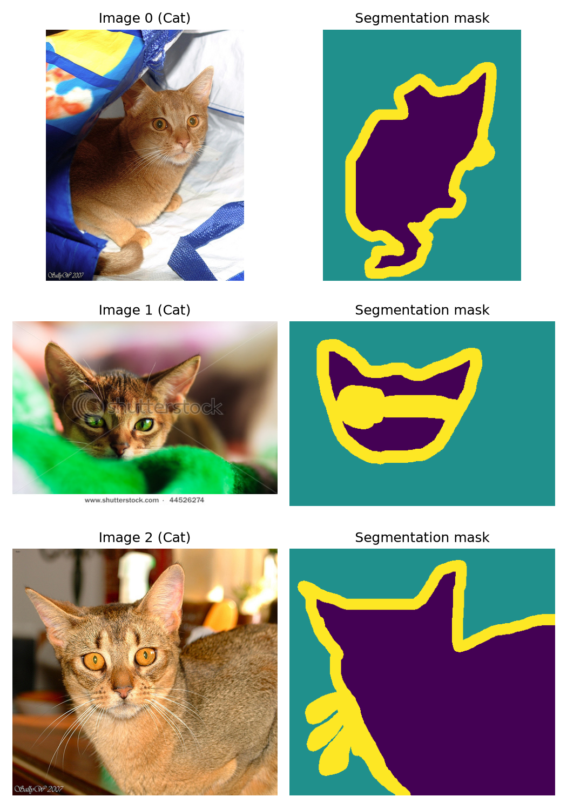
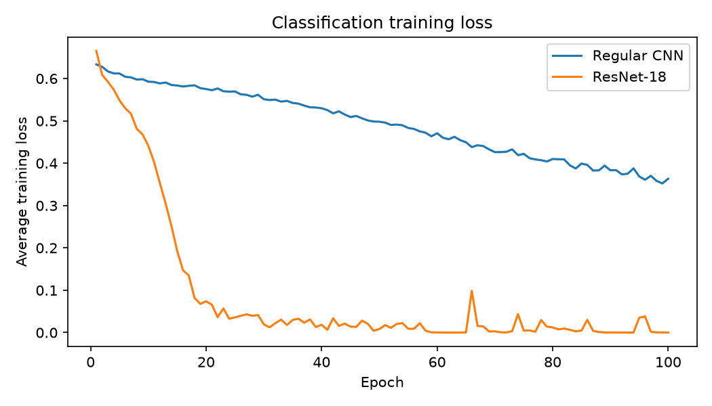
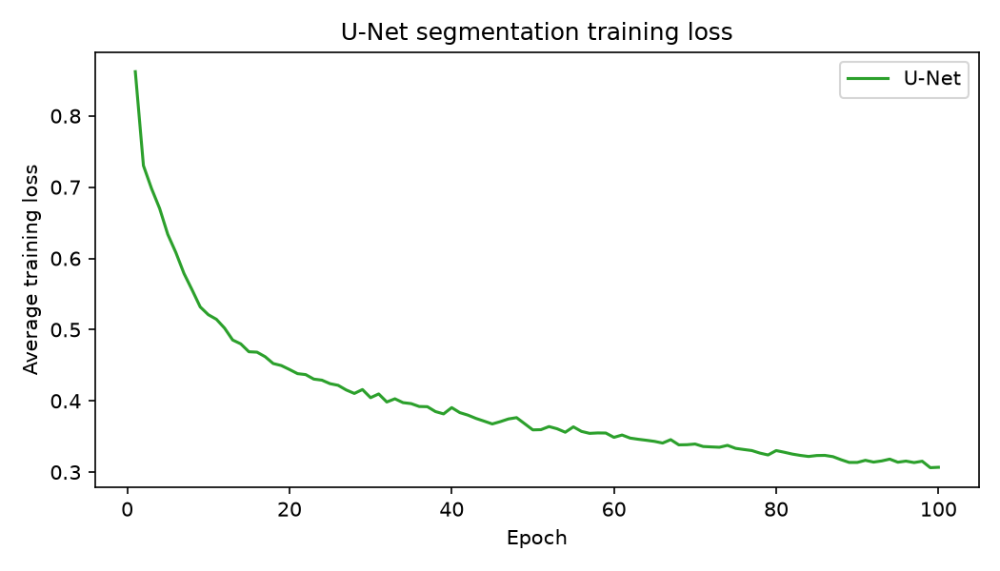
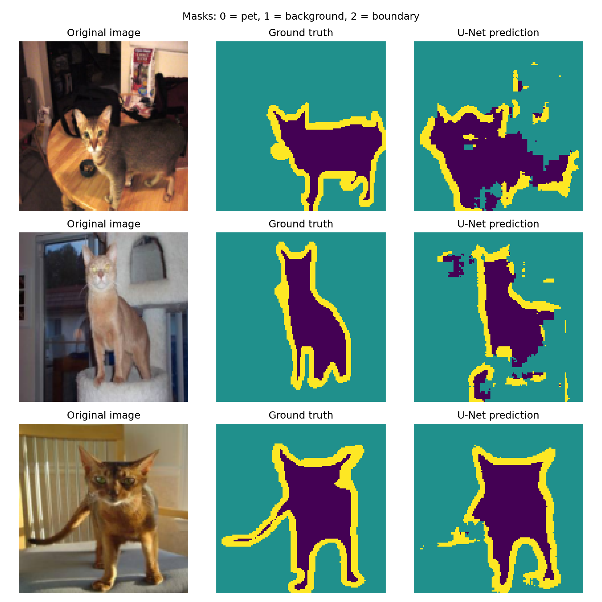

# a5-cnn-resnet-unet

This project trains three models from scratch on the Oxford-IIIT Pet dataset:

- a regular CNN and a ResNet-18 for **cat vs dog classification**
- a small U-Net for **pixel-level segmentation** (pet / background / boundary)

## 1. Setup, how to run, and training settings

### Install dependencies

```bash
pip install -r requirements.txt
```

| Package | 
|---|---|
| torch | 2.11.0+cu128 |
| torchvision | 0.26.0+cu128 |
| numpy | 2.5.3 |
| matplotlib | 3.11.2 |
| scikit-learn | 1.9.1 |
| tqdm | 4.70.1 |

I trained on an NVIDIA GPU, so PyTorch has to be a CUDA build. A plain `pip install torch` on Windows gives a CPU-only build. I used:

```bash
pip install torch torchvision --index-url https://download.pytorch.org/whl/cu128
```

### Download the data

```bash
python data.py
```

### Run the code

Run everything from inside the assignment folder, in this order:

```bash
python explore.py        # dataset info, sample figure, batch shapes
python train_cnn.py      # trains the regular CNN, saves cnn.pt and cnn_losses.json
python train_resnet.py   # trains ResNet-18, saves resnet.pt and resnet_losses.json
python train_unet.py     # trains the U-Net, saves unet.pt and unet_losses.json
python evaluate.py       # test metrics, loss plots, segmentation figure
```

`evaluate.py` loads the saved `.pt` files and does not retrain. The `.pt` files are not committed to the repository.

### Hardware

**GPU.** I used my latops GPU for training, I have a high end laptop with a 5070 gpu and intel i9 porcessor. 

### Training settings

All three models used the same settings, with no hyperparameter tuning. I did not use the test set to choose any settings.

| Setting | Value |
|---|---|
| Random seed | 0 (`torch.manual_seed(0)`) |
| Optimizer | Adam |
| Learning rate | 0.001 |
| Batch size | 16 |
| Epochs | 100 (the suggested value, used for all three models) |
| Loss | `nn.CrossEntropyLoss` on raw outputs (no softmax) |
| Initialization | Random, no pretrained weights |
| Classifier targets | `labels` (0 = cat, 1 = dog) |
| U-Net targets | `masks` (0 = pet, 1 = background, 2 = boundary) |

The regular CNN and ResNet-18 have identical budgets (same epochs, optimizer, learning rate and batch size), so any difference between them comes from the model, not the training setup.

### Model architectures

**Regular CNN** (output `[B, 2]`)

- `Conv2d(3, 16, 3, padding=1)`, ReLU, `MaxPool2d(2)`
- `Conv2d(16, 32, 3, padding=1)`, ReLU, `MaxPool2d(2)`
- `Conv2d(32, 64, 3, padding=1)`, ReLU
- `AdaptiveAvgPool2d((1, 1))`, flatten, `Linear(64, 2)`

**ResNet-18** (output `[B, 2]`)

- `torchvision.models.resnet18(weights=None)`, with `model.fc` replaced by `nn.Linear(model.fc.in_features, 2)` before the optimizer was created. All parameters are trainable.

**Small U-Net** (output `[B, 3, 128, 128]`)

- `DoubleConv(in, out)` is two 3x3 convolutions (padding 1), each followed by ReLU.
- Encoder: `DoubleConv(3, 16)` saved as E1, `MaxPool2d(2)`, `DoubleConv(16, 32)` saved as E2, `MaxPool2d(2)`.
- Bottleneck: `DoubleConv(32, 64)`.
- Decoder: `ConvTranspose2d(64, 32, 2, stride=2)`, concatenate with E2, `DoubleConv(64, 32)`, then `ConvTranspose2d(32, 16, 2, stride=2)`, concatenate with E1, `DoubleConv(32, 16)`.
- Output: `Conv2d(16, 3, kernel_size=1)`.
- The two skip connections use `torch.cat(..., dim=1)`.

## 2. Results and analysis

### Dataset information

- Training samples: 3680
- Testing samples: 3669
- First training image: size (width, height) = (394, 500), label = 0 (Cat)
- First training mask: size (width, height) = (394, 500), unique values = `[1 2 3]` (raw masks use 1, 2, 3)



*The first three training images next to their raw segmentation masks, drawn with the same color map (`viridis`, range 1 to 3).*

### Processed batch shapes

With `get_loaders(batch_size=16)`, images are resized to 128 x 128 and masks are converted to 0, 1, 2:

| Tensor | Shape |
|---|---|
| `images` | `[16, 3, 128, 128]` |
| `labels` | `[16]` |
| `masks` | `[16, 128, 128]` |

### Classification accuracy

| Model | Test accuracy |
|---|---|
| Regular CNN | 0.7989 |
| ResNet-18 | 0.7790 |
| Always-Dog baseline (majority class) | 0.6776 |

### U-Net pixel accuracy

**Pixel accuracy on the test set: 0.8459.**

The pixel accuracy is another measure of performance and is thus not meant to compete with the classifiers. The pixel accuracy is high if the entire background area has been classified correctly even if the shape of the pet has not been captured.

### Training-loss plots



*Average training loss per epoch for the regular CNN and ResNet-18.*



*Average training loss per epoch for the U-Net.*

### Segmentation examples



*The first three test images with their ground-truth masks and U-Net predictions. Masks use 0 = pet, 1 = background, 2 = boundary, with the same color map and `vmin=0, vmax=2`.*

### Analysis

**Classification comparison.** The standard CNN model was able to achieve a test accuracy of 0.7989, which is slightly above ResNet-18's 0.7790; the difference is just 2 percentage points. They both outperformed the always Dog baseline by about 12 and 10 points, respectively. So they were actually able to learn something about the pictures, even though the bias towards class imbalance still exists. The more complex model wasn't superior in this case. ResNet-18 had an extremely low training loss while maintaining a lower test accuracy compared to the CNN model, implying that it was overfitted due to the use of no pre-trained weights and no data augmentation techniques. All of those numbers are based on one experiment with seed = 0, so I consider the 2 percentage point difference insignificant.

**Training losses.** Training loss for the CNN model decreased smoothly from 0.633 in epoch 1 to 0.363 in epoch 100 with slight fluctuations every epoch but had not reached its lowest level yet. ResNet-18's training loss decreased much faster from 0.665 in epoch 1 to under 0.2 in epoch 15 reaching 0.0001 between epochs 61 and 64. Afterwards it started to fluctuate with some peaks (like 0.0987 at epoch 66 and 0.0353 and 0.0380 at epochs 95 and 96), recovering in several epochs and ended at 0.0002. Training loss for U-Net decreased sharply during the first 10 epochs from 0.862 to 0.521 and afterwards it decreased slowly approaching its final value of 0.307. These are all training losses. Classification loss and segmentation loss are used for different tasks so there is no direct comparison between them.

**Segmentation results.** The U-Net detects the location of the pet and its overall shape. In the three images, the prediction of the location of the pet is somewhat accurate and in the third image, the head, body, and the boundary ring are all accurately predicted. However, the predictions made by the model are not as smooth and accurate as the ground truths. The edges are irregular, with the boundaries being jagged and the ring being discontinuous. Furthermore, in the images with a lot of objects around (first and second images), the model marks some areas in the background as either pet or boundary objects such as an object around the door or on the table. It seems to struggle with detecting the thin parts of the image – in the third image, the tail of the pet is barely detected at all, and in the first image, the legs of the pet are not properly segmented from each other. This is consistent with the pixel accuracy of 0.8459, which can have a very good score even if the boundaries are incorrect since there are lots of pixels in the background that are correct. A cat/dog label only says what the animal is, while the segmentation output says where the pet is, how large it is and what shape it has, and it exposes failure cases, such as the missed tail and the false detections in cluttered backgrounds, that a single accuracy number hides.

### GenAI acknowledgment

I used Claude (Anthropic) as a coding helper, it helped me debug and write some of the code. 
